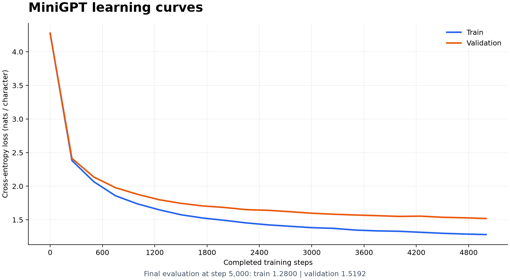

# MiniGPT

A **4.59-million-parameter, character-level GPT** trained from random initialization on Tiny Shakespeare. It generates text one character at a time using a decoder-only transformer with causal self-attention.

Built by **Dimitris Pantzopoulos** while following **Andrej Karpathy's** [Let's build GPT: from scratch, in code, spelled out.](https://www.youtube.com/watch?v=kCc8FmEb1nY) tutorial and adapting its [reference implementation](https://github.com/karpathy/ng-video-lecture). This repository documents that implementation, its trained checkpoint and the training workflow added around it.

## Try the trained model

From the project directory, install the dependencies and use the included checkpoint:

```bash
python -m pip install -r requirements.txt
python generate.py --checkpoint Models/TransformerWeights/best.pt --prompt "ROMEO:" --max-new-tokens 500
```

The checkpoint includes its architecture and character vocabulary, so generating text does not require the training dataset. Inference selects CUDA when available and otherwise runs on the CPU.

## What it can do

- **Continue a text prompt** with sampled characters, learning speaker labels, line breaks and word patterns from Shakespeare's plays.
- **Train a configurable transformer from scratch**, with adjustable context length, embedding width, attention heads, layers and batch size.
- **Save and resume training**, including model weights, vocabulary, optimizer state and step count, while keeping the checkpoint with the lowest measured validation loss.
- **Make training visible** through TensorBoard, CSV loss measurements and exported learning curves.

The model uses a sliding **256-character context window** and a **65-character vocabulary**. Generated dialogue can lose coherence and contain invented words; the sample below shows its current behavior directly.

## Generated example

An unedited sample from the included step-5,000 checkpoint, prompted with `ROMEO:` and sampled for 600 new characters on CPU with seed `1337`:

```text
ROMEO:
Then my wait, I am boy: then, the had he graceful of
The true as the make of a fresh
As if good and still knowledging; threI be concent:
Nurse I am some it?

BENVOLIO:
For even matter too white you so, we deserve you
For your gastes, the wonty weak not indeed; after;
And stand upon mine earl that back'd back'd as it
on her course her did, though to can recease had I shall
Whice moution some is too words to be a grief,
And a poor the lease, in statation and bent
Made blief against his look, I perofe,
He hen Isabel be no let I love to the queen,
He eurly. Come, gentleman, we for this Edward Cla
```

[Full sample](docs/generation_sample.txt) · [Generation settings and checkpoint checksum](docs/generation_sample.json)

Sampling is stochastic, so the command above can produce a different continuation.

## Training results

This run completed **5,000 optimizer steps** on a **Google Colab NVIDIA T4**. The model has **4,586,561 parameters**, with 6 transformer layers, 6 attention heads, 384 embedding channels, a 256-character context window and a 65-character vocabulary. Training used a batch size of 64 and AdamW with a learning rate of `3e-4`.

| Final measurement | Value |
| --- | ---: |
| Completed optimizer steps | 5,000 |
| Train loss | **1.2800** |
| Validation loss | **1.5192** |

Losses are cross-entropy in nats per character, averaged over **20 sampled batches per split** with dropout disabled during evaluation. Evaluation ran every 250 steps. The lowest recorded validation loss was at step 5,000; the best and latest checkpoints contain identical model weights.



The run resumed from its step-1,250 checkpoint after an SSH disconnect. The curve combines the measurements before and after resuming, using the resumed evaluation for the repeated step 1,250. It shows measured losses without smoothing.

[Download the trained checkpoint](Models/TransformerWeights/best.pt) · [Download the measured losses (CSV)](docs/losses.csv) · [View the checkpoint metadata and checksums](docs/model_info.json)

## Train

Use Python 3.10 or newer with a compatible PyTorch build. With the dependencies installed, start a fresh run from the project directory:

```bash
python -m data.download_data  # only if data/raw/input.txt is missing
python train.py --log-dir runs/showcase
```

CUDA is selected automatically when available. The defaults are 5,000 optimizer steps, a batch size of 64, 256-character sequences, 384 embedding channels, 6 heads and 6 layers. Reduce `--batch-size` if GPU memory is insufficient.

Every run gets its own directory. Omit `--log-dir` for a timestamped directory, or choose a new name for each experiment; existing run directories are never overwritten.

```text
runs/showcase/
  events.out.tfevents.*  # TensorBoard events
  losses.csv            # step, train_loss, val_loss
  loss_curve.png        # README-ready chart, refreshed at each evaluation
  latest.pt             # weights after the latest completed evaluation
  best.pt               # weights with the lowest validation loss so far
```

## Save, download and use the model

Checkpoints are saved automatically at step zero, every evaluation, and after the final optimizer step. `latest.pt` is replaced at each evaluation; `best.pt` changes only when validation loss improves. Each checkpoint includes the model weights, architecture settings, character vocabulary, optimizer state, step and measured losses. Writes use a temporary file followed by replacement, so an incomplete write does not replace the previous checkpoint.

Before stopping the Colab VM, download the selected checkpoint from your local PowerShell terminal:

```powershell
colab download -s minigpt /content/MiniGPT/runs/showcase/best.pt Models/TransformerWeights/best.pt
```

Use your actual run name (for example, `showcase-fast`). Then generate text locally from the project directory:

```bash
python generate.py --checkpoint Models/TransformerWeights/best.pt --prompt "ROMEO:" --max-new-tokens 500
```

The checkpoint includes the vocabulary, so generation does not need the training dataset. It selects CUDA when available and otherwise uses the CPU. An interrupted run retains its last saved evaluation checkpoint; deleting the VM still removes checkpoints that have not been downloaded.

### Continue an interrupted run

Use the latest checkpoint and a **new** results directory. This restores the weights and AdamW optimizer, reads the architecture from the checkpoint, checks the dataset vocabulary, and continues the step counter. `--max-iters 5000` means finish at total step 5,000, rather than performing 5,000 additional updates. The previous run's best checkpoint is carried into the new directory when present.

```bash
python train.py --resume runs/saved/latest.pt --log-dir runs/saved-resumed --max-iters 5000 --eval-interval 250 --eval-iters 20
```

To keep training alive when SSH disconnects, run it in the background with its output saved to a log:

```bash
nohup python -u train.py --resume runs/saved/latest.pt --log-dir runs/saved-resumed --max-iters 5000 --eval-interval 250 --eval-iters 20 > runs/saved-resumed.log 2>&1 < /dev/null &
tail -f runs/saved-resumed.log
```

After reconnecting, return to the project directory and run `tail -f runs/saved-resumed.log` again. Ctrl+C stops viewing the log without stopping the background training process. This survives an SSH disconnect while the Colab VM remains available; it does not prevent Colab from terminating the VM.

## Loss curves

The CSV, TensorBoard events and PNG contain the same measured evaluation losses. Both train and validation losses are averaged over 100 sampled batches by default, with dropout disabled during evaluation. Evaluations run before training, every 50 completed optimizer steps, and after the final step. Change the frequency with `--eval-interval` and the averaging with `--eval-iters`.

The PNG shows unsmoothed cross-entropy in nats per character; lower is better. Its footer reports the latest recorded step and losses. CSV and TensorBoard output are flushed at every evaluation, and the PNG is replaced atomically, so an interrupted run retains results through its last completed evaluation. A VM deletion still removes local run files, so download them before stopping Colab.

### Watch training in TensorBoard

In a second terminal on the machine holding the run files:

```bash
tensorboard --logdir runs --host 127.0.0.1 --port 6006
```

Open http://localhost:6006 and select `Loss/train` and `Loss/validation` under Scalars. The training script writes events; TensorBoard is started separately. TensorBoard smoothing affects its display only, not the saved CSV or PNG.

For a Colab notebook connected to the same VM, use:

```python
%load_ext tensorboard
%tensorboard --logdir /content/MiniGPT/runs
```

### Update the published curve

The published chart is generated from `docs/losses.csv`. To render it again:

```bash
python training_metrics.py docs/losses.csv --output docs/loss_curve.png
```

For a new published run, update the CSV, chart, checkpoint metadata and the results above together. Keep the original measurements so readers can reproduce the figure. Full run directories are ignored by Git.

### Download results from Colab

From your local PowerShell terminal, while the VM is still running:

```powershell
New-Item -ItemType Directory -Force docs | Out-Null
colab download -s minigpt /content/MiniGPT/runs/showcase/loss_curve.png docs/loss_curve.png
colab download -s minigpt /content/MiniGPT/runs/showcase/losses.csv docs/losses.csv
```

Use your actual Colab session and run-directory names. To recreate the image locally from the downloaded CSV:

```bash
python training_metrics.py docs/losses.csv --output docs/loss_curve.png
```

## Credits and provenance

- **Andrej Karpathy**: the [video tutorial](https://www.youtube.com/watch?v=kCc8FmEb1nY) and [ng-video-lecture reference code](https://github.com/karpathy/ng-video-lecture) provide the foundation for this implementation. The reference repository identifies its license as MIT.
- **Training data**: [Tiny Shakespeare from karpathy/char-rnn](https://github.com/karpathy/char-rnn/tree/master/data/tinyshakespeare).
- **This project**: Dimitris Pantzopoulos's tutorial-based implementation and training experiment, organized into model, data, training and generation modules, with checkpoint/resume support, training instrumentation and published results.

The model design follows the tutorial. The code, measured results and generated sample here reflect this repository's implementation. The project license is [MIT](LICENSE).
